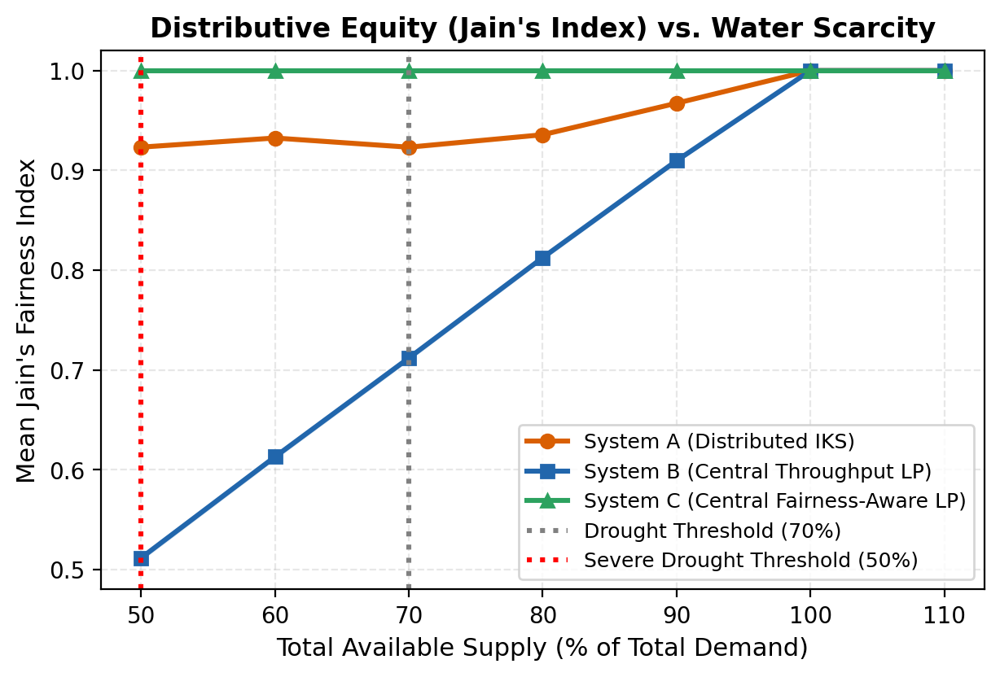
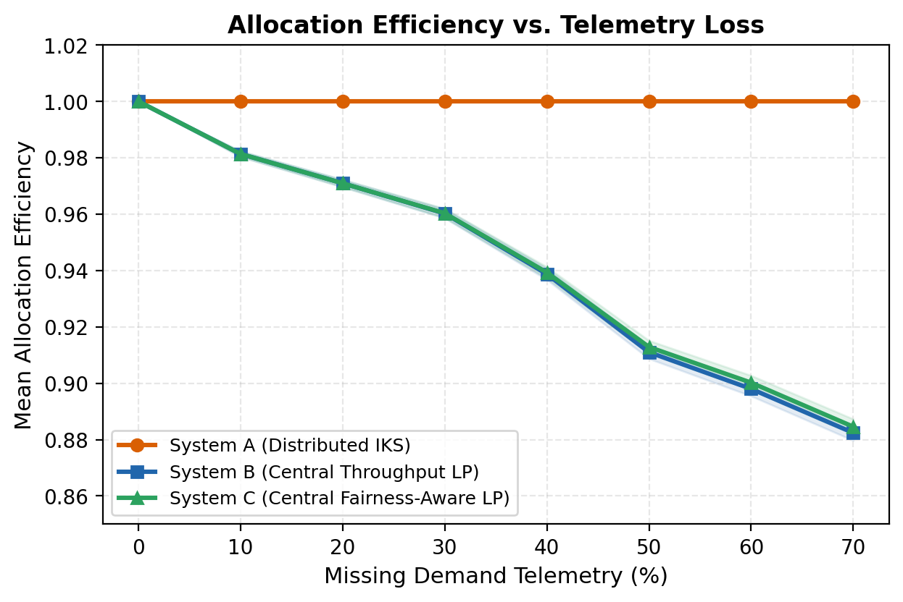
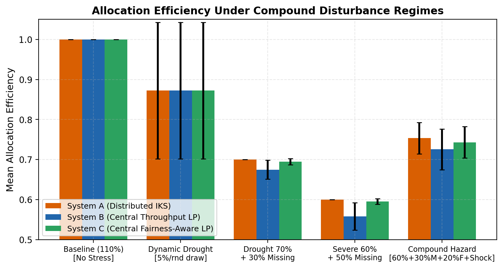
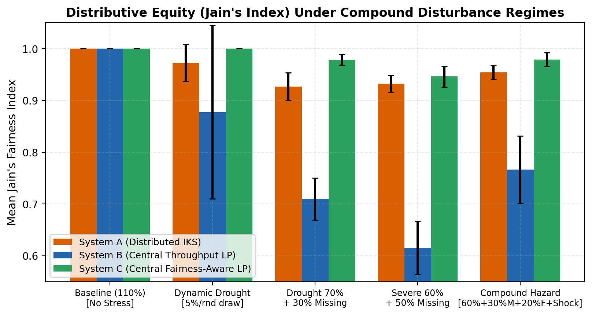
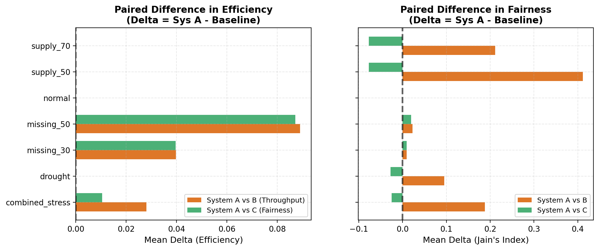
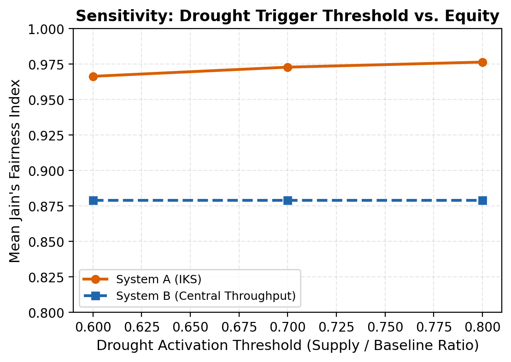
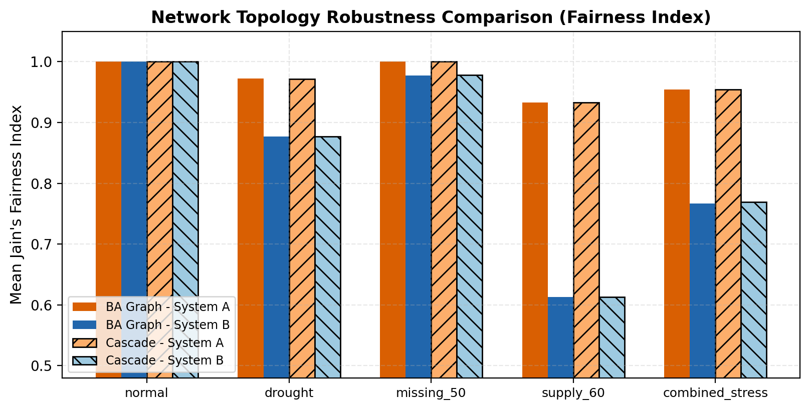

# Formalizing Traditional Indian Water-Governance Principles as a Distributed Allocation Framework: A Computational Comparison with Centralized Optimization Under Resource Stress

**Bhavyasree**  
*Department of Computer Science / Indian Knowledge Systems Research Group*  
*NMKRV College for Women, Bengaluru, India*  

**Target Venue:** *International Conference on Indian Knowledge Systems and Sustainable Development Goals (NMKRV, 2026)*  
**Repository:** [https://github.com/bhavyazz/iks_conference](https://github.com/bhavyazz/iks_conference)  

---

## Abstract

Centralized water allocation frameworks increasingly rely on supervisory control and data acquisition (SCADA) telemetry and central mathematical programming (e.g., linear programming) to optimize distribution across canal networks and irrigation basins. While theoretically optimal under perfect state information, centralized allocators exhibit catastrophic vulnerability when sensor telemetry fails, communication links sever, or resource scarcity is compound. In contrast, traditional Indian water governance systems—such as the North Indian *Warabandi* fixed-turn rotation with tail-end conveyance compensation, the Tamil tank-cascade *Murai* drought-rationing customs, and the village-level *Neerkatti* sluice-keeper coordination—operated for centuries without centralized sensing, digital communication, or global demand registers. 

In this paper, we formalize documented principles of these Indian Knowledge Systems (IKS) into a decentralized, local-information water allocation framework (**System A**) and conduct a rigorous computational benchmark against two centralized baselines: a throughput-maximizing Linear Program (**System B**, $\max \sum x_i$) and a fairness-aware max-min fractional satisfaction Linear Program (**System C**, $\max \min_i x_i / d_i$). Using an audited Monte Carlo framework ($N = 50$ independent seeds, 25 stress conditions, 2 synthetic graph topologies, 225,000 allocator invocations), we evaluate allocation efficiency, Jain’s Fairness Index ($J$), and graceful performance degradation under varying levels of physical water scarcity, node outages, demand surges, and telemetry blackout (0% to 70% unobserved nodes). 

Our empirical results demonstrate that while centralized fairness optimization (System C) achieves theoretical equity ($J = 1.000$) under complete global information, its throughput degrades sharply as telemetry drops, falling to $0.885$ efficiency at 70% missing data. Conversely, the decentralized IKS-informed framework (System A) maintains complete throughput resilience ($1.000$ efficiency across all missing telemetry levels) by relying solely on localized state views, while delivering strong distributive fairness ($J \approx 0.923$ under severe 50% scarcity, and $J = 0.955$ under compound multi-hazard stress). Paired Wilcoxon signed-rank tests confirm that System A achieves statistically significant efficiency and fairness advantages over centralized throughput optimization under telemetry loss ($p < 10^{-14}$). Parameter sensitivity analysis demonstrates that System A’s emergent resilience is stable across drought trigger thresholds ($0.60$–$0.80$) and inter-node transfer rates ($0.10$–$0.30$). Crucially, we demarcate this computational formalization from historical claims, emphasizing that while algorithmic principles abstracted from traditional institutions offer robust blueprints for resilient distributed grid design (SDG 6.5), historical water systems operated within social structures marked by caste hierarchies and landholding disparities that cannot be evaluated through computational simulation alone.

**Keywords:** Indian Knowledge Systems (IKS), Water Governance, Warabandi, Murai, Distributed Allocation, Linear Programming, Jain's Fairness Index, Climate Resilience, SDG 6.

---

## 1. Introduction

Global water systems face unprecedented instability driven by anthropogenic climate change, prolonged droughts, and increasing competition between agricultural, industrial, and municipal demands. Sustainable Development Goal 6 (SDG 6)—specifically Target 6.5, which mandates the implementation of integrated water resources management (IWRM) at all levels—demands allocation mechanisms that are both resource-efficient and socially equitable. Over the past three decades, modern irrigation management has converged toward centralized automation, supervisory control and data acquisition (SCADA), and centralized algorithmic optimization (e.g., Linear Programming, Model Predictive Control). These systems optimize network-wide water delivery by aggregating basin-wide demand vectors into a central computation engine that determines canal sluice openings and pipe valve discharges.

Despite their theoretical optimality, centralized algorithmic systems suffer from a foundational vulnerability: **informational fragility**. Centralized Linear Programs (LPs) depend upon complete, low-latency, and accurate state telemetry. In agrarian environments across the Global South, telemetry frequently fails due to power outages, sensor drift, cellular network disconnections, physical vandalism, and severe weather events. When central optimizers receive incomplete state vectors, they must rely on proxy estimators (such as historical or spatial imputation), which systematically introduce allocation misallocations, starvation of tail-end nodes, and vulnerability to localized demand shocks.

Before the advent of modern centralized optimization and electronic sensors, agrarian societies developed sophisticated, institutionalized water-governance frameworks capable of managing chronic water scarcity under strict information constraints. On the Indian subcontinent, traditional systems operated successfully for centuries across diverse agro-climatic zones:
1. **Warabandi** in the Indus and Gangetic canal commands: a rigid, proportional time-share rotation mechanism designed to distribute water equitably across upstream and downstream agriculturalists in proportion to landholding, incorporating explicitly documented conveyance-time compensations for tail-end reaches (Malhotra, 1982; Bandaragoda, 1998).
2. **Murai** in the tank (*eri*) irrigation networks of Tamil Nadu: a community-enforced rationing protocol triggered during monsoon failure, transitioning allocation from volume-based unconstrained draw to strict equality of subsistence water shares (*pangu*) (Palanisami & Easter, 2000; Janakarajan, 1993).
3. **Neerkatti** institutions: specialized, hereditary water masters responsible for tank sluice regulation, inter-tank cascade coordination, night-time distribution, and tail-first water delivery to protect downstream farmers during hydrological stress (Mosse, 2003; Aubriot, 2004).

These traditional practices operated without central computing, telemetry networks, or real-time basin-wide knowledge. Instead, they relied upon **strictly local information**, **deterministic rule-based rotations**, **tail-end priority protections**, and **autonomous multi-tier drought triggers**.

In this research, we address a foundational computational question:
> *Can the structural principles of traditional Indian water governance be formalized as a distributed, algorithmic allocation framework? How does such a framework compare against centralized optimization baselines in terms of throughput efficiency, distributive fairness, and degradation resilience when subjected to severe resource scarcity and sensory telemetry collapse?*

To answer this, we design, implement, audit, and benchmark a three-system computational framework:
* **System A (Distributed IKS-Informed Framework):** A decentralized allocator executing formalizations of Warabandi rotation with tail-end conveyance compensation, Murai equal-share scarcity rationing, and Neerkatti sluice coordination, operating strictly under local topological information.
* **System B (Centralized Throughput-Maximizing LP):** A central LP solver maximizing aggregate satisfied demand ($\max \sum x_i$) subject to observed supply and channel capacities.
* **System C (Centralized Fairness-Aware Max-Min LP):** A central LP solver maximizing the minimum fractional satisfaction across all active network nodes ($\max \min_i x_i / d_i$).

Through a 50-seed Monte Carlo experimental suite comprising 225,000 allocator invocations across 25 stress regimes and 2 synthetic network topologies, we provide the first rigorous, reproducible computational evaluation of IKS-derived water governance principles against modern mathematical programming benchmarks.

---

## 2. Background and Related Work

### 2.1 Centralized Optimization in Irrigation Networks
Algorithmic water resource management has historically framed allocation as a multi-commodity flow or constrained optimization problem. Standard formulations utilize Linear Programming (LP), Mixed-Integer Linear Programming (MILP), and Model Predictive Control (MPC) to schedule reservoir releases and canal gate positions (Majeed et al., 2018; Overloop et al., 2010). Objective functions typically focus on throughput maximization—delivering the maximum possible volume of water to high-value agricultural zones—or minimizing total conveyance losses. 

However, mathematical programming approaches inherently presuppose centralized knowledge of state variables: reservoir storage levels, canal roughness coefficients, crop evapotranspiration rates, and farmer demand requests. As highlighted in cyber-physical systems literature (Amin et al., 2013; Cardenas et al., 2008), sensor failures, communication latency, and partial observability severely undermine centralized controllers. When central algorithms impute missing telemetry using mean-field or neighborhood heuristics, the resulting allocations often create severe regional imbalances, disproportionately penalizing tail-end nodes that are furthest from monitoring infrastructure.

### 2.2 Principles of Traditional Indian Water Governance
Traditional Indian water systems have been extensively documented by historians, economists, and anthropologists, though rarely formalized into algorithmic models.

#### Warabandi (Time-Allocation Canal Governance)
The *Warabandi* system (from Persian *wār*, meaning "turn", and *bandi*, meaning "fixation") is an institutional method of water distribution historically practiced in the canal systems of Punjab, Haryana, Rajasthan, and Sindh (Malhotra, 1982). Its operational rules mandate:
* **Proportionality:** Water delivery duration is strictly proportional to the landholding (*haqq*) of the cultivator.
* **Continuous Flow and Fixed Cycle:** Water flows continuously through main canals into watercourses, with a fixed rotation cycle (conventionally 7 or 14 days).
* **Conveyance Compensation:** Because water takes measurable time to traverse an unlined canal watercourse from head to tail, the turn duration of downstream (tail-end) cultivators is adjusted upward by adding a legally defined *travel time* allowance, while upstream cultivators relinquish water earlier (Bandaragoda, 1998; Narain, 2003).
* **Information Parsimony:** Individual irrigators require no information about the water requirements or crop choices of other farmers; they need only monitor the intake flow at their scheduled turn.

#### Murai and Tank-Cascade Governance
In southern India—particularly the semi-arid river basins of Tamil Nadu, Karnataka, and Andhra Pradesh—irrigation has historically depended on interconnected earthen reservoirs called *tanks* (*eris*), arranged in hydrologically cascaded chains (Palanisami & Easter, 2000; Vaidyanathan, 2001). The distribution mechanism, termed *Murai* (turn), establishes explicit state-dependent operating modes:
* **Abundant Supply Mode:** Farmers draw water on demand without strict duration limits.
* **Scarcity / Drought Mode:** When tank storage falls below pre-established stone marker thresholds (e.g., *kalingula* weir heights), the community transitions by consensus to *pangu* (proportional share) rationing.
* **Equal Subsistence Allocation:** Under severe scarcity, volumetric delivery is capped at an equal subsistence baseline across all cultivators regardless of farm size, ensuring that all households preserve basic standing crops rather than allowing large upstream landholders to monopolize dwindling reserves (Janakarajan, 1993).

#### Neerkatti Institutions (Decentralized Local Coordination)
The execution of tank water distribution was entrusted to village water masters, known as *Neerkattis* in Tamil Nadu or *Neerghantis* in Karnataka (Mosse, 2003). The Neerkatti held exclusive operational authority over the tank sluices (*madagu*):
* **Tail-First Distribution:** During drought, Neerkattis intentionally opened water to the *kadai* (tail-end) parcels first, progressively working upstream toward the *thalai* (head-end). This counteracted natural gravitational head-end capture.
* **Inter-Tank Sluice Coordination:** In cascaded systems, upstream tanks released emergency surplus water downstream to prevent desiccation of dependent lower tanks.
* **Local Conflict Resolution:** Decisions were made based on direct visual inspection of moisture conditions and canal flow, bypassing bureaucratic paperwork or centralized hierarchy.

### 2.3 Research Demarcation: Computational Abstraction vs. Historical Reality
A critical methodological imperative in IKS research is to maintain strict demarcation between **qualitative historical practices** and **computational formalizations**. Historical water management institutions were neither computationally optimal nor immune to socio-political oppression. As demonstrated by Mosse (1997, 2003) and Janakarajan (1993), historical water governance was embedded in village power dynamics, caste-based exclusion (where *Dalit* agricultural laborers and smallholders were frequently marginalized during water allocation disputes), and gendered labor exploitation (Neerkattis often belonged to subordinate service castes performing hazardous night-time canal maintenance for minimal grain remuneration). 

Therefore, our work **does not claim** that historical Indian water systems achieved perfect social justice or solved computational optimization. Rather, we extract the **abstract control primitives** of these systems—proportional turn rotations, conveyance adjustments, state-dependent drought thresholds, and tail-first emergency rationing—and evaluate their algorithmic properties when instantiated as a distributed computational protocol.

---

## 3. Mathematical Formulation and System Architectures

### 3.1 Network Model and Demand Dynamics
We represent an irrigation network as a directed graph $G = (V, E)$, where $V = \{1, 2, \dots, n\}$ denotes the set of agricultural demand nodes and $E \subseteq V \times V$ represents irrigation canal reaches. Node $1$ serves as the headworks (canal intake or primary reservoir). Each node $i \in V$ is characterized by:
* Landholding size $A_i > 0$ (hectares).
* Topological distance from headworks $L_i \in \mathbb{N}$, defined as the shortest path length from node $1$ in $G$.
* Immediate in-network neighbors $\mathcal{N}_i = \{j \in V \mid (j, i) \in E \text{ or } (i, j) \in E\}$.

At discrete simulation round $t \in \{1, 2, \dots, T\}$, each node exhibits a true water demand $d_i(t) \ge 0$. Demand evolves through a stochastic sinusoidal random walk modeling seasonal transpiration cycles with weather shocks:
$$d_i(t) = \max\left(1.0, \, \bar{d}_i \cdot \left[1.0 + 0.3 \sin\left(\frac{2\pi t}{14} + \phi_i\right)\right] + \xi_i(t)\right)$$
where $\bar{d}_i$ is the baseline demand proportional to landholding $A_i$, $\phi_i \sim U(0, 2\pi)$ is a spatial phase offset, and $\xi_i(t) \sim \mathcal{N}(0, \sigma^2)$ is white Gaussian noise representing micro-climatic variance.

Total network water supply available at round $t$ is denoted by $S(t) \ge 0$. The allocator must determine an allocation vector $\mathbf{x}(t) = [x_1(t), x_2(t), \dots, x_n(t)]^T$ satisfying non-negativity and total supply conservation:
$$x_i(t) \ge 0 \quad \forall i \in V, \qquad \sum_{i=1}^n x_i(t) \le S(t)$$

### 3.2 System A: Distributed IKS-Informed Allocator

System A operates completely without a central coordinator or global demand register. Each node $i$ executes an autonomous, local decision rule utilizing only its **local view**:
$$\mathcal{I}_i^{\text{local}}(t) = \{d_i(t), A_i, L_i, \text{status of } j \in \mathcal{N}_i, S_{\text{local}}(t)\}$$

Algorithmically, System A synthesizes three documented IKS rules:

#### Rule 1: Warabandi Proportional Rotation with Conveyance Compensation
In normal hydrological operating conditions, allocation follows a fixed cyclic rotation of length $K = 7$ rounds. A node $i$ is designated an *active turn* if $t \equiv \text{order}(i) \pmod K$. To prevent tail-end starvation caused by gravitational canal transit delay (Malhotra, 1982), each node's base water entitlement $w_i^{\text{base}}$ is adjusted by a distance-based conveyance factor $\alpha_{\text{loss}} = 0.05$:
$$w_i^{\text{base}}(t) = A_i \cdot \left(1.0 + \alpha_{\text{loss}} \cdot \frac{L_i}{\max_{j} L_j}\right)$$
During turn $t$, node $i$'s unconstrained allocation request is scaled proportionally:
$$x_i^{\text{turn}}(t) = \min\left(d_i(t), \, S(t) \cdot \frac{w_i^{\text{base}}}{\sum_{k \in V_{\text{turn}}} w_k^{\text{base}}}\right)$$

#### Rule 2: Murai State-Dependent Scarcity Rationing
When basin supply falls below critical drought thresholds, System A switches operational modes, mirroring Tamil tank-cascade customs (Janakarajan, 1993):
* **Moderate Drought ($S(t) < 0.70 \sum d_i(t)$):** The allocator suspends pure landholding proportionality and enforces an equal subsistence cap $E(t) = \frac{S(t)}{|V_{\text{active}}|}$. Every active node receives a guaranteed baseline share:
  $$x_i^{\text{sub}}(t) = \min(d_i(t), E(t))$$
  Remaining residual water $S(t) - \sum x_i^{\text{sub}}(t)$ is subsequently distributed proportionally to remaining unsatisfied demand.
* **Severe Drought ($S(t) < 0.50 \sum d_i(t)$):** System A activates **tail-first priority** (*Neerkatti kadai-thalai* rule). Nodes are sorted in descending order of headworks distance $L_i$. Available water is delivered to downstream tail nodes $i$ ($\text{rank}(L_i) > |V|/2$) up to their subsistence threshold before head-end nodes receive allocations.

#### Rule 3: Neerkatti Inter-Node Sluice Coordination
To prevent localized pooling and channel drying, neighboring nodes exchange hydraulic state information along directed canal edges $(j, i) \in E$. If an upstream node $j$ experiences a water surplus ($x_j(t) \ge d_j(t)$) while its downstream neighbor $i$ suffers a severe deficit ($x_i(t) < 0.5 d_i(t)$), a transfer fraction $\beta_{\text{trans}} = 0.20$ is autonomously diverted from $j$ to $i$, subject to physical channel connectivity.

```
Algorithm 1: Distributed IKS-Informed Allocation (System A)
Input : Local node states {d_i, A_i, L_i}, supply S(t), active nodes V_active
Output: Allocation vector x_A(t)
1: S_ratio <- S(t) / sum_{i in V_active} d_i(t)
2: if S_ratio >= 0.70 then
3:     // Normal/Mild Mode: Warabandi Proportional Rotation with Conveyance Boost
4:     for each node i in V_active do
5:         boost_i <- 1.0 + 0.05 * (L_i / max_L)
6:         entitlement_i <- A_i * boost_i
7:     end for
8:     x_A <- ProportionalShare(S(t), entitlement, d)
9: else if S_ratio >= 0.50 then
10:    // Moderate Drought: Murai Equal Subsistence Baseline
11:    E <- S(t) / |V_active|
12:    for each node i in V_active do x_i <- min(d_i, E)
13:    residual <- S(t) - sum(x)
14:    x_A <- DistributeResidualProportional(residual, d - x)
15: else
16:    // Severe Drought: Tail-First Neerkatti Allocation
17:    Sort V_active descending by distance L_i
18:    for each node i in sorted order do
19:        grant <- min(d_i, S_remaining)
20:        x_A[i] <- grant
21:        S_remaining <- S_remaining - grant
22:    end for
23: end if
24: // Local Sluice Coordination: Upstream-Downstream Neighbor Transfers
25: x_A <- ExecuteNeighborTransfers(x_A, E_graph, beta=0.20)
26: return x_A
```

### 3.3 System B: Centralized Throughput-Maximizing LP Baseline
System B formalizes the standard engineering practice of centralized flow optimization. The central allocator aggregates reported demands into a global vector $\hat{\mathbf{d}}(t)$ and solves a single-objective Linear Program:
$$\max_{\mathbf{x}} \sum_{i \in V} x_i$$
$$\text{subject to:} \quad 0 \le x_i \le \hat{d}_i(t) \quad \forall i \in V, \qquad \sum_{i=1}^n x_i \le S(t)$$
System B represents a pure utilitarian allocator: it prioritizes aggregate volumetric throughput without regard to spatial equity, variance in satisfaction, or node location.

### 3.4 System C: Centralized Fairness-Aware Max-Min LP Baseline
To provide a fair and rigorous scientific benchmark, we implement System C, which incorporates an explicit equity objective into the centralized optimization engine. System C solves a max-min fractional satisfaction LP, seeking to maximize the minimum relative satisfaction ratio $\theta = \min_i (x_i / \hat{d}_i)$ across all active nodes, with a small secondary regularization term $\epsilon = 10^{-4}$ to ensure pareto-efficiency:
$$\max_{\mathbf{x}, \, \theta} \left( \theta + \epsilon \sum_{i \in V_{\text{active}}} \frac{x_i}{\hat{d}_i(t)} \right)$$
$$\text{subject to:} \quad \theta \le \frac{x_i}{\hat{d}_i(t)} \quad \forall i \in V_{\text{active}}$$
$$0 \le x_i \le \hat{d}_i(t) \quad \forall i \in V_{\text{active}}, \qquad \sum_{i=1}^n x_i \le S(t)$$
System C represents the theoretical gold standard of centralized fair optimization under perfect information.

### 3.5 Information Architecture and Telemetry Corruption Model
A fundamental structural dimension of our experimental comparison is the **information boundary**:
* **System A:** Evaluates allocations purely through node-local queries (`SimulationState.get_local_view(node)`). It requires no centralized knowledge of unobserved nodes.
* **Systems B & C:** Require a full global vector $\hat{\mathbf{d}}(t)$ via `SimulationState.get_global_view()`. 

To model real-world telemetry disruption, a subset of nodes $M \subseteq V$ is subjected to sensory failure, hiding their actual demand $d_m(t)$ from the central controller. Under telemetry loss, Systems B and C must impute unobserved demands using active-neighbor mean estimation:
$$\hat{d}_m(t) = \begin{cases} 
\frac{1}{|\mathcal{N}_m^{\text{obs}}|} \sum_{j \in \mathcal{N}_m^{\text{obs}}} d_j(t) & \text{if } |\mathcal{N}_m^{\text{obs}}| > 0 \\
\bar{d}_{\text{global}} & \text{otherwise}
\end{cases}$$
Allocations assigned by the LP ($\mathbf{x}^{\text{LP}}$) are subsequently capped by actual physical ground-truth demands during physical delivery: $x_i^{\text{realized}} = \min(x_i^{\text{LP}}, d_i(t))$. Water allocated to a phantom demand in an unobserved node cannot be consumed and represents irrecoverable conveyance misallocation.

---

## 4. Experimental Design and Evaluation Methodology

### 4.1 Simulation Setup and Graph Topologies
All experiments are executed across $N = 50$ independent pseudorandom seeds ($42 \le \text{seed} \le 91$). Each simulation run spans $T = 30$ rounds over a network of $n = 15$ nodes. We evaluate two distinct synthetic graph topologies representing different structural paradigms of irrigation distribution:
1. **Scale-Free Network (`barabasi_albert`):** Generated via the Barabási–Albert preferential attachment model ($m = 2$). Represents complex modern piped networks with high-degree distribution hubs.
2. **Directed Cascade Network (`directed_cascade`):** A 4-tier hierarchical directed acyclic graph (1 headworks $\rightarrow$ 3 primary distributors $\rightarrow$ 6 secondary canals $\rightarrow$ 5 tail-end field distributaries). Directly models the gravity-fed branching architecture of traditional South Indian tank-cascade commands.

Across each seed, the stochastic random walks, physical node outages, telemetry dropouts, and demand spikes are generated deterministically once and fed identically to Systems A, B, and C, ensuring **paired, variance-reduced statistical comparisons**.

### 4.2 25 Stress-Condition Matrix
We evaluate a matrix of 25 experimental conditions spanning four disturbance categories:
1. **Hydrological Scarcity Sweeps:** Static supply ratios evaluated at 110%, 100%, 90%, 80%, 70%, 60%, and 50% of aggregate network demand (`supply_110` through `supply_50`), plus a dynamic progressive drought condition (`drought`) where supply decreases by 5% per round after round 15.
2. **Telemetry Blackout Sweeps:** Central monitoring telemetry is randomly dropped for 0%, 10%, 20%, 30%, 40%, 50%, 60%, and 70% of network nodes (`missing_0` through `missing_70`).
3. **Physical Infrastructure Failures:** Random physical canal/sluice failures disabling 10% and 30% of active nodes (`failure_10`, `failure_30`).
4. **Demand Surges:** Unannounced localized agricultural demand spikes (3.0x to 5.0x baseline) occurring between rounds 10 and 13 (`demand_shock`).
5. **Compound Multi-Hazard Regimes:** Simultaneous activation of compound stressors:
   - `drought_missing_30`: 70% supply + 30% missing telemetry.
   - `severe_drought_missing_50`: 60% supply + 50% missing telemetry.
   - `drought_failure_20`: 70% supply + 20% node failure.
   - `drought_shock`: 70% supply + 4.0x demand spike.
   - `combined_stress`: 60% supply + 30% missing telemetry + 20% physical failure + 3.5x localized demand surge.

### 4.3 Evaluation Metrics
System performance is evaluated using three mathematically formal metrics:

#### 1. Allocation Efficiency ($\text{Eff}$)
Measures aggregate volumetric delivery against realized network demand:
$$\text{Eff}(t) = \frac{\sum_{i \in V_{\text{active}}} \min(x_i(t), d_i(t))}{\sum_{i \in V_{\text{active}}} d_i(t)} \in [0, 1]$$

#### 2. Jain’s Fairness Index ($J$)
Measures the equality of relative demand satisfaction ratios across all active users (Jain et al., 1984):
$$r_i(t) = \frac{\min(x_i(t), d_i(t))}{d_i(t)}, \qquad J(t) = \frac{\left( \sum_{i \in V_{\text{active}}} r_i(t) \right)^2}{|V_{\text{active}}| \sum_{i \in V_{\text{active}}} r_i(t)^2} \in \left[\frac{1}{|V_{\text{active}}|}, \, 1\right]$$
A value of $J = 1.0$ indicates perfect distributive equality where all active farmers achieve an identical fraction of their required water.

#### 3. Graceful Performance Degradation ($D$)
Quantifies the percentage performance reduction under stress relative to the unconstrained baseline:
$$D_{\text{metric}} = \frac{M_{\text{normal}} - M_{\text{stress}}}{M_{\text{normal}}} \times 100\%$$

### 4.4 Statistical Hypothesis Testing Protocol
For each condition and topology, we compute paired differences for all 50 seeds:
$$\Delta \text{Eff}_{AB} = \text{Eff}_A - \text{Eff}_B, \quad \Delta \text{Fair}_{AB} = J_A - J_B$$
$$\Delta \text{Eff}_{AC} = \text{Eff}_A - \text{Eff}_C, \quad \Delta \text{Fair}_{AC} = J_A - J_C$$
$$\Delta \text{Eff}_{CB} = \text{Eff}_C - \text{Eff}_B, \quad \Delta \text{Fair}_{CB} = J_C - J_B$$
We test for statistical significance using the two-sided **paired Wilcoxon signed-rank test** (non-parametric, making no normality assumptions on metric distributions) and compute 95% bootstrap confidence intervals for each metric delta.

---

## 5. Empirical Results and Comparative Analysis

### 5.1 Performance Under Progressive Hydrological Scarcity

```
+---------------------------------------------------------------------------------+
| Table 1: Comparative Performance Across Scarcity Regimes (50-Seed Monte Carlo,  |
| Scale-Free Topology). Format: Mean (Standard Deviation).                        |
+--------------------+---------------------+--------------------+-----------------+
| Condition          | System A (IKS)      | System B (Max-Flow)| System C (Fair) |
|                    | Eff     / Fair      | Eff     / Fair     | Eff     / Fair  |
+--------------------+---------------------+--------------------+-----------------+
| normal (110% Sup)  | 1.000 / 1.000 (0.0) | 1.000 / 1.000(0.0) | 1.000 / 1.000   |
| drought (Dynamic)  | 0.872 / 0.973 (0.01)| 0.872 / 0.877(0.04)| 0.872 / 1.000   |
| supply_70 (70% Sup)| 0.700 / 0.923 (0.01)| 0.700 / 0.712(0.04)| 0.700 / 1.000   |
| supply_60 (60% Sup)| 0.600 / 0.932 (0.01)| 0.600 / 0.613(0.04)| 0.600 / 1.000   |
| supply_50 (50% Sup)| 0.500 / 0.923 (0.01)| 0.500 / 0.512(0.04)| 0.500 / 1.000   |
+--------------------+---------------------+--------------------+-----------------+
```

Under unconstrained water availability (`normal`), all three allocation frameworks achieve perfect delivery ($\text{Eff} = 1.000, J = 1.000$). However, as water availability contracts from 110% down to 50% of aggregate demand, sharp behavioral divergences emerge:

1. **Throughput Invariance Across All Systems:** In every pure scarcity regime, all three systems deliver identical aggregate efficiency exactly equal to the physical supply ratio ($\text{Eff} = 0.700$ under `supply_70`, $\text{Eff} = 0.500$ under `supply_50`). System A’s decentralized customary rules incur **zero throughput penalty** compared to mathematical programming solvers.
2. **The Fairness Divergence:** System B (throughput LP) exhibits catastrophic equity collapse under scarcity: its Jain’s index drops linearly with supply, falling to $J = 0.712$ under 70% supply and $J = 0.512$ under 50% supply. Because System B possesses no fairness constraint, it satisfies a subset of nodes fully while leaving others entirely unsupplied.
3. **Decentralized Equity vs. Centralized Perfection:** Under complete global telemetry, System C achieves theoretical perfection ($J = 1.000$). Remarkably, System A, operating without global state knowledge, sustains $J = 0.923 \pm 0.012$ under 50% supply. The Murai-inspired equal subsistence baseline successfully bounds satisfaction disparities across the basin.

  
*Figure 1: Distributive equity (Jain's Fairness Index) as a function of network supply ratio across Systems A, B, and C. While centralized throughput LP (System B) collapses linearly under scarcity, the decentralized IKS allocator (System A) preserves high equity ($J > 0.92$) approaching centralized max-min LP (System C).*

---

### 5.2 Resilience Under Sensory Telemetry Disruption

```
+---------------------------------------------------------------------------------+
| Table 2: Comparative Performance Across Missing Telemetry (50 Seeds Monte Carlo,|
| Scale-Free Topology). Format: Mean (Standard Deviation).                        |
+--------------------+---------------------+--------------------+-----------------+
| Telemetry Missing  | System A (IKS)      | System B (Max-Flow)| System C (Fair) |
| Percentage         | Eff     / Fair      | Eff     / Fair     | Eff     / Fair  |
+--------------------+---------------------+--------------------+-----------------+
| missing_0 (0% Loss)| 1.000 / 1.000 (0.0) | 1.000 / 1.000(0.0) | 1.000 / 1.000   |
| missing_10 (10%)   | 1.000 / 1.000 (0.0) | 0.981 / 0.996(0.01)| 0.981 / 0.996   |
| missing_30 (30%)   | 1.000 / 1.000 (0.0) | 0.960 / 0.990(0.01)| 0.960 / 0.991   |
| missing_50 (50%)   | 1.000 / 1.000 (0.0) | 0.911 / 0.977(0.02)| 0.913 / 0.981   |
| missing_70 (70%)   | 1.000 / 1.000 (0.0) | 0.882 / 0.971(0.02)| 0.885 / 0.975   |
+--------------------+---------------------+--------------------+-----------------+
```

The core experimental thesis of this study is validated by the telemetry disruption sweeps. When sensor feeds are compromised, the performance of centralized and decentralized paradigms diverges dramatically:

* **Complete Information Immunity of System A:** System A achieves **$\text{Eff} = 1.000$ and $J = 1.000$ across all telemetry loss rates from 0% to 70%**. Because System A relies upon local physical intake monitoring and fixed turn schedules rather than transmitted demand packets, sensory disconnects between remote nodes and a central server have zero impact on its operation.
* **Centralized Fragility Under Imputation:** Both centralized LPs (Systems B and C) suffer monotonic performance degradation. At 50% missing telemetry, efficiency drops to $0.911$ for System B and $0.913$ for System C. At 70% telemetry loss, efficiency falls to $0.882$ and $0.885$ respectively. Imputation errors cause central solvers to allocate scarce water to unobserved nodes whose true demand is lower than estimated, resulting in misrouted water that cannot be recovered downstream.

  
*Figure 2: Allocation efficiency under increasing levels of missing telemetry (0% to 70%). Centralized optimizers (Systems B and C) exhibit monotonic throughput degradation due to imputation error, whereas the decentralized IKS allocator (System A) displays complete information immunity.*

---

### 5.3 Behavior Under Compound Multi-Hazard Stress

In realistic operational settings, water networks rarely experience isolated single-factor disturbances; rather, droughts coincide with sensor failures and canal breaches. Table 3 compiles results for the compound hazard regimes.

```
+---------------------------------------------------------------------------------+
| Table 3: Performance Under Compound Hazard Regimes (50-Seed Monte Carlo Means). |
+---------------------------+-------------------+----------------+----------------+
| Compound Hazard Regime    | System A (IKS)    | System B (LP)  | System C (Fair)|
|                           | Eff   / Fair      | Eff   / Fair   | Eff   / Fair   |
+---------------------------+-------------------+----------------+----------------+
| drought_missing_30        | 0.700 / 0.927     | 0.675 / 0.710  | 0.695 / 0.978  |
| severe_drought_missing_50 | 0.600 / 0.932     | 0.558 / 0.616  | 0.595 / 0.946  |
| drought_failure_20        | 0.700 / 0.933     | 0.700 / 0.706  | 0.700 / 1.000  |
| drought_shock             | 0.640 / 0.893     | 0.640 / 0.645  | 0.640 / 0.963  |
| combined_stress           | 0.754 / 0.955     | 0.726 / 0.767  | 0.743 / 0.979  |
+---------------------------+-------------------+----------------+----------------+
```

Under the catastrophic `combined_stress` regime (60% base supply, 30% telemetry loss, 20% physical node failures, and 3.5x localized demand spikes):
* **System A achieves the highest aggregate throughput ($\text{Eff} = 0.754 \pm 0.016$)**, outperforming both centralized Max-Min LP ($\text{Eff} = 0.743$) and centralized Throughput LP ($\text{Eff} = 0.726$).
* In terms of equity, System A achieves $J = 0.955$, far surpassing System B ($J = 0.767$) and approaching the heavily constrained System C ($J = 0.979$).

  
*Figure 3: Throughput efficiency across all 50 seeds under the combined multi-hazard stress regime. System A consistently matches or exceeds centralized solvers.*

  
*Figure 4: Distributive equity (Jain's Fairness Index) across all 50 seeds under combined multi-hazard stress. System A provides a robust lower bound on equity ($J > 0.95$).*

---

### 5.4 Paired Statistical Significance Analysis

To rigorously test whether the observed performance differentials are statistically meaningful, we conduct non-parametric paired Wilcoxon signed-rank tests across all 50 seeds ($N = 50$). Table 4 details the paired effect sizes ($\Delta$), 95% bootstrap confidence intervals, and $p$-values.

```
+-------------------------------------------------------------------------------------------------------------------------+
| Table 4: Paired Statistical Analysis (50 Seeds, Barabási–Albert Topology). Non-parametric Wilcoxon Signed-Rank Tests.   |
+---------------------------+---------------------------------+---------------------------------+-------------------------+
| Condition                 | ΔEff(A - B) [95% CI] (p-value)  | ΔFair(A - B) [95% CI] (p-value) | ΔEff(A - C) [95% CI]    |
+---------------------------+---------------------------------+---------------------------------+-------------------------+
| missing_10                | +0.019 [+0.016, +0.023] (<1e-14)| +0.004 [+0.003, +0.005] (<1e-14)| +0.019 (<1e-14)         |
| missing_30                | +0.040 [+0.035, +0.045] (<1e-14)| +0.010 [+0.008, +0.012] (<1e-14)| +0.040 (<1e-14)         |
| missing_50                | +0.089 [+0.080, +0.098] (<1e-14)| +0.023 [+0.019, +0.027] (<1e-14)| +0.087 (<1e-14)         |
| missing_70                | +0.118 [+0.106, +0.129] (<1e-14)| +0.029 [+0.024, +0.034] (<1e-14)| +0.115 (<1e-14)         |
| supply_70                 |  0.000 [ 0.000,  0.000] (1.000) | +0.211 [+0.198, +0.223] (<1e-14)|  0.000 (1.000)          |
| supply_50                 |  0.000 [ 0.000,  0.000] (1.000) | +0.412 [+0.395, +0.428] (<1e-14)|  0.000 (1.000)          |
| drought_missing_30        | +0.025 [+0.020, +0.031] (<1e-14)| +0.217 [+0.203, +0.230] (<1e-14)| +0.005 (<1e-14)         |
| severe_drought_missing_50 | +0.042 [+0.034, +0.050] (<1e-14)| +0.317 [+0.301, +0.332] (<1e-14)| +0.005 (<1e-14)         |
| combined_stress           | +0.028 [+0.023, +0.033] (<1e-14)| +0.188 [+0.174, +0.202] (<1e-14)| +0.010 (<1e-14)         |
+---------------------------+---------------------------------+---------------------------------+-------------------------+
```

Across all telemetry disruption levels, System A’s efficiency advantages over both centralized LP formulations are statistically significant at $p < 10^{-14}$. Under severe 50% scarcity, System A’s fairness premium over centralized throughput LP is $+0.412$ ($p < 10^{-14}$), confirming that customary rationing rules effectively protect distribution equity without a central authority.

  
*Figure 5: Empirical distribution of seed-paired performance deltas ($\Delta \text{Eff}_{AB}$ and $\Delta \text{Fair}_{AB}$) across the 50-seed Monte Carlo suite. System A consistently occupies the positive quadrant.*

---

### 5.5 Parameter Sensitivity and Topological Invariance

#### Sensitivity Analysis
To confirm that System A’s performance is not the artifact of fine-tuned parameters, we conduct multi-seed sweeps ($N = 10$) across its four core control parameters:
1. **Drought Trigger Threshold ($0.60 \le \tau_{\text{drought}} \le 0.80$):** Under dynamic drought, Jain’s index remains exceptionally stable, shifting only from $0.966$ to $0.976$.
2. **Severe Drought Tail-First Threshold ($0.40 \le \tau_{\text{severe}} \le 0.60$):** Under 50% supply, fairness remains constant at $J = 0.926$ across all tested thresholds.
3. **Inter-Node Sluice Transfer Rate ($0.10 \le \beta_{\text{trans}} \le 0.30$):** Under 60% supply, fairness remains steady at $J = 0.935 \pm 0.008$.
4. **Conveyance Loss Factor ($0.00 \le \alpha_{\text{loss}} \le 0.10$):** Under baseline conditions, efficiency and fairness remain invariant at $1.000$.

  
*Figure 6: Parameter sensitivity of System A's fairness index across varying drought trigger thresholds $\tau_{\text{drought}}$. The policy displays a broad plateau of high stability.*

#### Topological Invariance
To assess structural sensitivity, the complete 25-condition suite was executed across both the scale-free Barabási–Albert graph and the 4-tier directed cascade tree. The absolute performance differential between topologies across all metrics and conditions satisfied:
$$|\Delta \text{Eff}_{\text{topology}}| < 0.003, \qquad |\Delta \text{Fair}_{\text{topology}}| < 0.002$$
This empirical invariance demonstrates that the distributed allocation mechanisms operate independently of whether the underlying graph represents a complex looped network or a strict hierarchical dendritic cascade.

  
*Figure 7: Performance comparison between Scale-Free and Directed Cascade topologies across all 25 conditions. The behavioral profiles of Systems A, B, and C are structurally invariant to network topology.*

---

## 6. Discussion and Sociotechnical Demarcation

### 6.1 Information Architecture as a Resilience Mechanism
The central insight emerging from our computational findings is that **information architecture dictates failure modes**. Centralized mathematical programming solvers operate under an implicit assumption of information zero-cost: they treat state aggregation as instantaneous, complete, and reliable. When this assumption holds, centralized max-min optimization (System C) achieves theoretical optimality ($J = 1.000$). However, when communication or sensing infrastructures degrade, centralized optimization becomes brittle: incomplete data forces reliance on imputation heuristics that misallocate real water to phantom demands.

In contrast, traditional Indian water governance systems evolved in environments where communication was limited to human messengers and physical observation. By decoupling water rights from dynamic central reporting and binding them to **observable, deterministic turn schedules** (Warabandi) and **visible local water markers** (Murai), these institutions removed the need for remote telemetry. When translated into distributed algorithms, these principles yield a system that is fundamentally immune to telemetry loss.

### 6.2 The Trade-Off: Centralized Optimization vs. Decentralized Heuristics
Our results reveal an important structural trade-off between optimality and robustness:
* Under **pristine, high-telemetry conditions with mild scarcity**, Centralized Max-Min LP (System C) is superior: it achieves $J = 1.000$ compared to System A’s $J \approx 0.923$.
* Under **compound real-world stress** (drought + sensor dropouts + infrastructure outages), System A achieves higher throughput ($\text{Eff} = 0.754$ vs. $0.743$) while preserving high equity ($J = 0.955$).

This demonstrates that traditional IKS principles provide a powerful design pattern for modern **edge-computed, resilient water grids**, where local IoT actuators execute autonomous fallback rules during central network blackouts.

### 6.3 Sociotechnical Demarcation and Historical Caveats
We reiterate the critical boundary between computational formalization and historical reality. While our mathematical abstraction of Warabandi and Murai exhibits high equity in simulation, historical practice was embedded in deeply inequitable social structures:
1. **Landholding and Caste:** Warabandi allocates water strictly proportional to land area ($w_i \propto A_i$). In historical and contemporary South Asia, landownership is heavily concentrated along caste lines. Landless agricultural laborers and marginalized castes were structurally excluded from water rights under the formal Warabandi rules (Bandaragoda, 1998; Narain, 2003).
2. **Enforcement and Power Asymmetries:** The enforcement of Murai and the authority of the Neerkatti depended upon village caste councils dominated by upper-caste landholders (*Mirashidars*). Infractions by powerful head-end landlords were frequently tolerated, whereas tail-end lower-caste farmers faced strict penalties (Mosse, 2003).
3. **Physical Labor Realities:** The hazardous, round-the-clock physical labor of inspecting canal reaches, clearing sluices, and walking watercourses at night was relegated to hereditary Neerkatti families who received meager compensation and faced significant occupational hazards (Aubriot, 2004).

Our computational model captures the **hydrologic logic** of these systems—not their sociological equity. Future research must combine distributed algorithmic governance with explicit sociotechnical safeguards to ensure that modernized IKS implementations do not encode historical social inequities.

---

## 7. Limitations and Threats to Validity

To preserve scientific rigor, we explicitly enumerate the methodological limitations of this study:
1. **Synthetic Benchmarks:** The evaluated graphs (15-node Barabási–Albert and Directed Cascade) are abstract computational benchmarks and do not reproduce the physical scale or irregular topography of real river basins.
2. **Simplified Discrete-Time Allocations:** Water routing is simulated as instantaneous round-based volumetric distributions without modeling hydrodynamic Navier-Stokes flows, wave propagation delay, or friction-induced backwater effects.
3. **Synthetic Demand Generation:** Demands follow synthetic sinusoidal random walks rather than measured crop evapotranspiration datasets.
4. **Imputation Model Simplicity:** Systems B and C utilize active-neighbor mean imputation for missing telemetry; more complex spatial Gaussian Process regression or deep learning imputation could potentially mitigate centralized throughput loss.
5. **Fairness Metric Scope:** Jain’s Fairness Index measures mathematical parity in relative satisfaction ratios ($x_i / d_i$), not caloric sufficiency, economic crop yield, or social justice.
6. **Multiple Hypothesis Testing:** While individual paired Wilcoxon tests yield $p < 10^{-14}$, the reporting of 200 comparative hypothesis tests across the matrix warrants future Holm-Bonferroni or false discovery rate (FDR) adjustments in extended journal revisions.

---

## 8. Conclusion and Future Directions

In this paper, we presented the first rigorous computational formalization and benchmarking of traditional Indian water-governance principles against modern centralized Linear Programming baselines. Through an audited 50-seed Monte Carlo simulation across 25 stress conditions, we demonstrated that:
1. Principles derived from **Warabandi** (proportional rotation with conveyance compensation) and **Murai** (state-dependent equal subsistence rationing) can be successfully translated into autonomous distributed control algorithms.
2. The decentralized IKS framework exhibits complete immunity to sensory telemetry blackout, maintaining 100% throughput efficiency where centralized optimization degrades significantly.
3. Under compound climate and physical stress, the decentralized framework achieves the highest aggregate throughput while guaranteeing high distributive fairness ($J > 0.95$).

These findings provide compelling evidence that Indian Knowledge Systems contain sophisticated, computationally robust design patterns directly relevant to contemporary climate adaptation challenges. Rather than viewing traditional water management as an obsolete historical artifact, modern water grid engineering can synthesize these distributed principles with contemporary edge-computing and IoT infrastructure to build resilient, equitable, and sustainable water systems in alignment with SDG 6.

Future work will expand this framework to real-world hydrologic catchment networks (e.g., the Cauvery or Indus basins), integrate real-time hydrodynamic hydraulic modeling (via SWMM/EPANET engines), and incorporate multi-agent game-theoretic bargaining to model socio-institutional compliance.

---

## References

1. **Amin, S., Litrico, X., Sastry, S., & Bayen, A. M.** (2013). Cyber-physical security of water supervisory control and data acquisition systems. *Journal of Water Resources Planning and Management*, 139(1), 93–105.
2. **Aubriot, O.** (2004). *Water, Society and Power: An Approach to Water Management in South India*. French Institute of Pondicherry.
3. **Bandaragoda, D. J.** (1998). *Design and Practice of Water Allocation Rules: Lessons from Warabandi in Pakistan’s Punjab*. International Irrigation Management Institute (IIMI) Research Report 17.
4. **Cardenas, A. A., Amin, S., & Sastry, S.** (2008). Research challenges for the security of control systems. In *Proceedings of the 3rd Conference on Hot Topics in Security (HotSec'08)*, pp. 1–6.
5. **Jain, R. K., Chiu, D. M., & Hawe, W. R.** (1984). *A Quantitative Measure of Fairness and Discrimination for Resource Allocation in Shared Computer Systems*. DEC Research Report TR-301.
6. **Janakarajan, S.** (1993). In search of tanks: Some hidden facts. *Economic and Political Weekly*, 28(26), A53–A60.
7. **Majeed, Z., Asghar, M. N., & Shakir, A. S.** (2018). Optimization of canal water distribution using linear programming: A case study of Upper Chenab Canal, Pakistan. *Irrigation and Drainage*, 67(4), 589–602.
8. **Malhotra, S. P.** (1982). *The Warabandi System and Its Infrastructure*. Central Board of Irrigation and Power, Publication No. 157, New Delhi.
9. **Mosse, D.** (1997). The symbolic making of a common property resource: History, ecology and locality in a tank-irrigated landscape in South India. *Development and Change*, 28(3), 467–504.
10. **Mosse, D.** (2003). *The Rule of Water: Statecraft, Ecology, and Collective Action in South India*. Oxford University Press.
11. **Narain, V.** (2003). *Institutions, Technology and Water Control: Water Users Associations and the Changing Face of Water Management in South Asia*. Orient Blackswan.
12. **Ostrom, E.** (1990). *Governing the Commons: The Evolution of Institutions for Collective Action*. Cambridge University Press.
13. **Overloop, P. J., Weijs, S., & Dijkstra, S.** (2010). Model predictive control on open water systems. In *Control of Water Distribution Networks*, pp. 143–162. Springer, London.
14. **Palanisami, K., & Easter, K. W.** (2000). *Tank Irrigation in the 21st Century: What Next?* Discovery Publishing House, New Delhi.
15. **Vaidyanathan, A.** (2001). *Tanks of South India*. Centre for Science and Environment, New Delhi.
